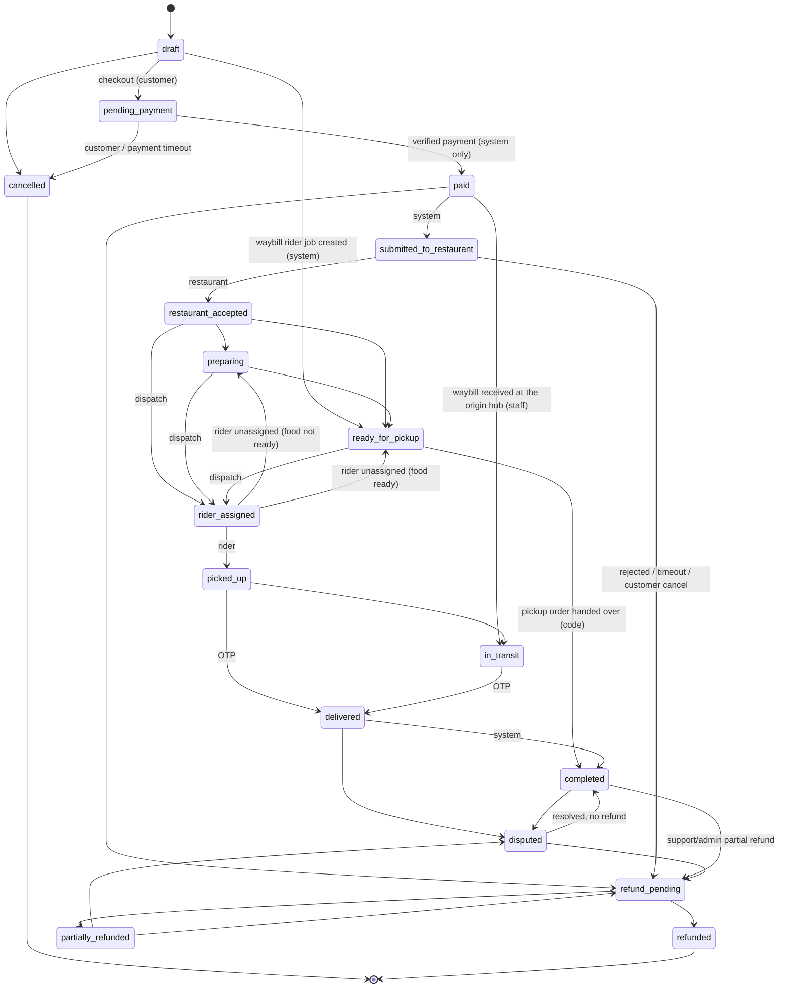

# Order Lifecycle & State Machine

The state machine lives in `services/api/src/gudmeal_api/domain/order_state.py` and is the
**only** code path allowed to change `orders/{id}.status`. Firestore security rules deny every
client write to `orders`, and the AI service can only *request* actions through API tools.

## States

`draft`, `pending_payment`, `paid`, `submitted_to_restaurant`, `restaurant_accepted`, `preparing`,
`ready_for_pickup`, `rider_assigned`, `picked_up`, `in_transit`, `delivered`, `completed`,
`cancelled`, `refund_pending`, `partially_refunded`, `refunded`, `disputed`.

Terminal: `cancelled`, `refunded`.

Several states also allow `→ refund_pending` by an operations admin (manual intervention).
The exhaustive table — including which actor may perform each transition and its guards — is the
`TRANSITIONS` table in code and is covered by `tests/unit/test_order_state.py`.

## Actors

| Actor | Source | Notes |
|---|---|---|
| `customer` | Firebase user who owns the order | checkout, cancel before acceptance, dispute |
| `restaurant` | staff with a role on the order's restaurant | accept / reject / preparing / ready / pickup hand-over |
| `rider` | the rider currently assigned to the order | pickup / in transit / deliver (OTP) |
| `system` | API internals (payment verifier, dispatch, timers) | never reachable from a client request body |
| `support` / `operations` / `super_admin` | staff roles | manual intervention — always audited, reason required |

## Guards

- **→ paid** only from the payment service after server-side verification of amount, currency and reference.
- **pending_payment → submitted_to_restaurant** (system) only for eligible **pay-on-delivery** orders; the cash
  is recorded when the rider confirms it at the door, before `delivered`.
- **Money guard** (`_money_guard`): an order holding customer money can only be refunded (`refund_pending`),
  never just cancelled; an unpaid pay-on-delivery order can only be cancelled (from any pre-delivery state,
  by the actors allowed for that state). See [ADR-0013](../adr/0013-wallet-and-cash.md).
- **→ delivered** requires the customer's 4-digit delivery code; 5 failed attempts lock the code. Orders with cash
  to collect (pay on delivery, vendor COD) also need the rider's `cash_collected` confirmation.
- **ready_for_pickup → completed** requires `fulfillment == "pickup"` and the pickup code.
- **Waybills** (`vertical = "waybill"`, [ADR-0015](../adr/0015-interstate-waybill.md)):
  - `paid → in_transit` happens when the origin hub scans the package in.
  - `in_transit → delivered` is done by the system when the last-mile rider delivers with the recipient's
    code, or by hub staff at collection with the recipient's collection code.
  - The detail (at the hub, departed, arrived, ready for collection, out for delivery) is `waybill.stage`
    plus milestones, changed by compare-and-set with each transition.
  - `_flow_guard` keeps these edges for waybills only.
- **Waybill rider jobs** (`leg_of` set):
  - They go `draft → ready_for_pickup` (system) without payment.
  - First-mile jobs are completed by the hub's scan, never by the rider.
  - Customers cannot check them out, cancel them or dispute them; the system can call them off before
    pickup.
- **Packages and waybills** never go to `submitted_to_restaurant`, so they never take the pay-on-delivery
  step.
- **rider transitions** require `order.rider_id == actor.uid`.
- **restaurant transitions** require the actor to hold a restaurant role for `order.restaurant_id`.
- Every transition is a compare-and-set on the current status (Firestore transaction) and appends an
  `order_events` record with actor, reason and timestamps.

## Readiness vs. assignment

Riders are usually dispatched while food is being prepared. When the rider accepts, the order moves to
`rider_assigned` even if the kitchen has not finished; the kitchen's "mark ready" action then only records
`ready_at`. If a rider is unassigned, the system restores `preparing` or `ready_for_pickup` based on `ready_at`.
