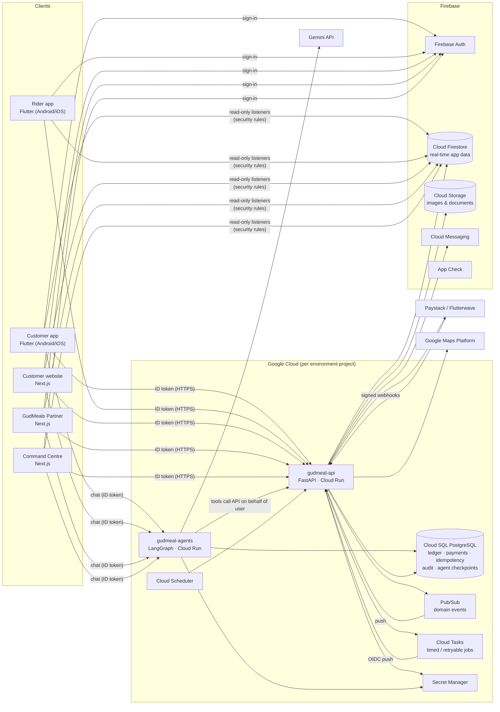
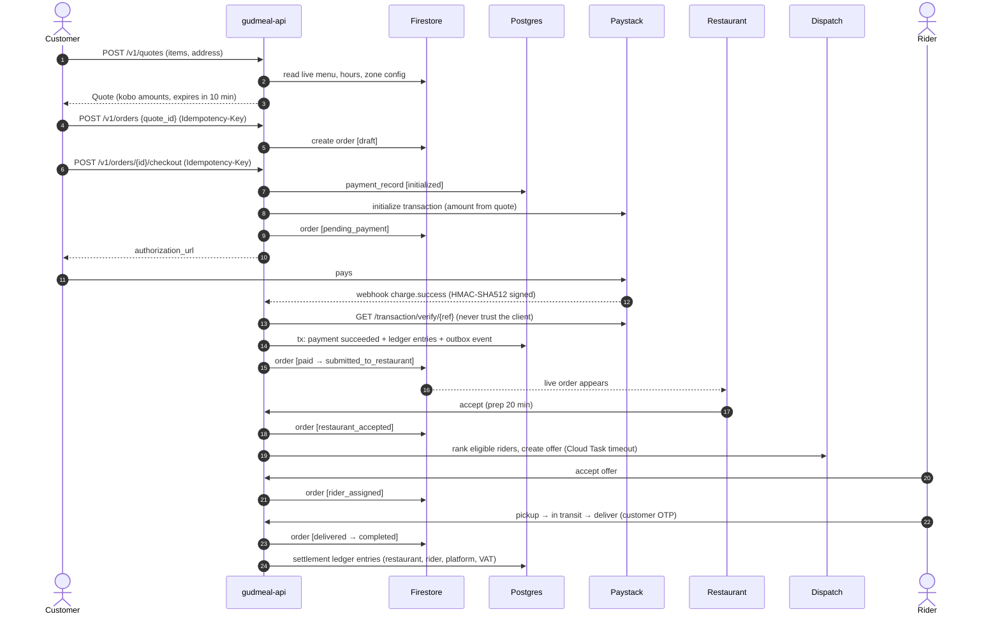

# GudMeals — System Architecture

> Status: living document. Decisions are recorded as ADRs in [`docs/adr`](../adr).

GudMeals is a set of separately deployable applications that share one identity system
(Firebase Authentication), one API (`gudmeal-api`), one real-time database (Cloud Firestore),
one money database (Cloud SQL PostgreSQL) and one AI service (`gudmeal-agents`).

## 1. System context



### Key properties

| Concern | Decision |
|---|---|
| Who may change order state? | Only `gudmeal-api`, through the validated order state machine ([ADR-0004](../adr/0004-order-state-machine-in-backend.md)). Firestore rules deny all client writes to `orders`. |
| Who may touch money? | Only `gudmeal-api` payment and ledger services. Amounts are integer kobo computed by the deterministic pricing engine ([ADR-0005](../adr/0005-integer-kobo-and-server-quotes.md)). |
| What does the AI do? | Plans and orchestrates. Every action is a typed tool call executed by the API with the end user's identity, permissions and idempotency ([ADR-0003](../adr/0003-langgraph-separate-service.md), [ADR-0008](../adr/0008-agent-tool-registry.md)). |
| How do clients get live updates? | Firestore listeners on documents the user is allowed to read (order, assignment, tracking). |
| How are side effects made reliable? | Transactional outbox in Postgres → Pub/Sub → push handlers; Cloud Tasks for timers ([ADR-0010](../adr/0010-events-outbox-pubsub-tasks.md)). |

## 2. Repository layout

```
apps/web            Customer website (Next.js)
apps/partner        GudMeals Partner — restaurant dashboard (Next.js)
apps/admin          GudMeals Command Centre — super admin (Next.js)
packages/ui         Shared React component library + Tailwind theme
packages/api-client Typed TypeScript client for gudmeal-api
packages/tokens     Design tokens (single source → CSS, TS, Dart)
mobile/core         Shared Flutter package (models, API client, theme)
mobile/customer     GudMeals customer app (Flutter)
mobile/rider        GudMeals Rider app (Flutter)
services/api        gudmeal-api (FastAPI, Python)
services/agents     gudmeal-agents (LangGraph, Python)
firebase            Firestore/Storage rules, indexes, emulator config, rules tests
infra               Cloud Build, deployment & bootstrap scripts
docs                Architecture, ADRs, runbooks, reports
```

## 3. Order flow (happy path, delivery)



## 4. Environments

| Environment | GCP / Firebase project | Purpose |
|---|---|---|
| development | `gud-meal-dev` (+ local emulators) | Feature work, sandbox payment keys |
| staging | `gud-meal-staging` | Pre-release verification with sandbox payments |
| production | `gud-meal-prod` | Live traffic; deploys require explicit approval |

Each environment has its own Firebase project, Cloud SQL instance, service accounts and secrets.
Nothing is shared across environments except container images in Artifact Registry.

## 5. Further reading

- [Order lifecycle & state machine](order-lifecycle.md)
- [Data model (Firestore + PostgreSQL)](data-model.md)
- [Payments & ledger](payments-and-ledger.md)
- [AI multi-agent system](ai-agents.md)
- [Security model](security.md)
